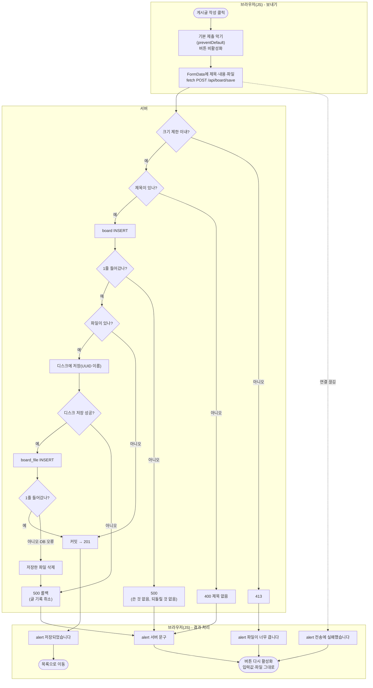
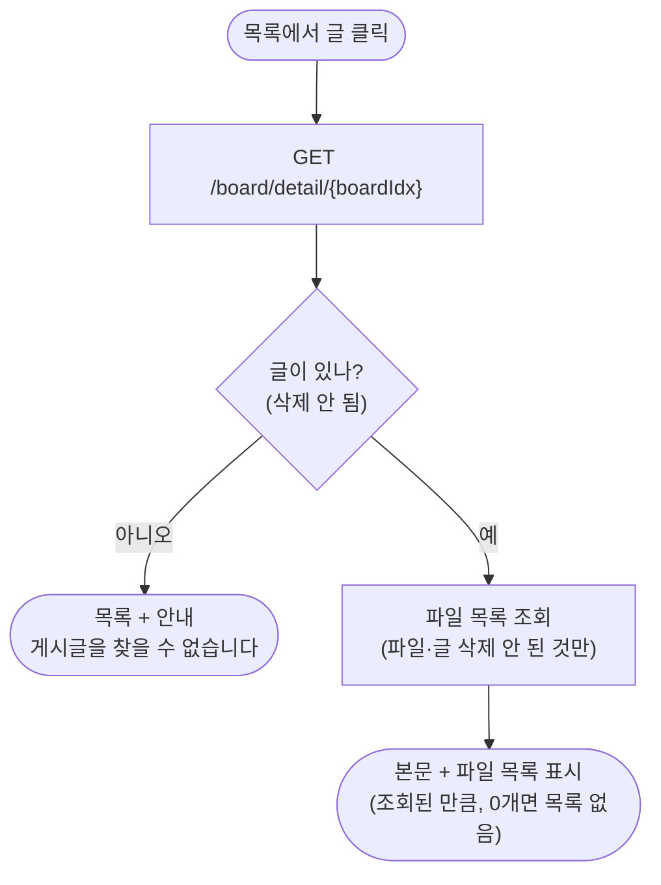
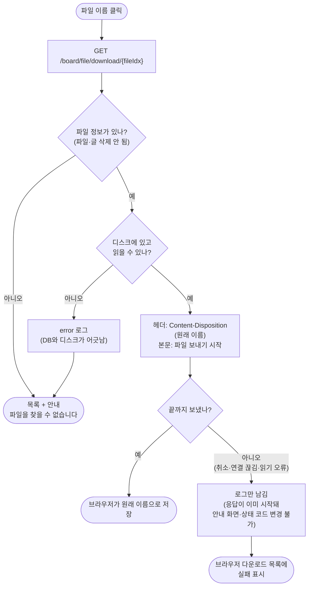

# 2026-10-27 작업 설계 — 글쓰기 fetch 저장, 첨부 파일 목록·내려받기

## 1. 개요

| 기능 | 목적 |
|---|---|
| ① 글쓰기 fetch 저장 | 피드백 반영: 저장 실패 시 화면이 초기화됨(입력값·파일 사라짐, 10/26), 버튼 중복 제출(10/19) |
| ② 첨부 파일 목록·내려받기 | 파일 입출력 중 "출력". 올린 파일을 상세에서 보고 받을 수 있게 |

- **진행 순서**: 10/27 ① 글쓰기 fetch 저장 → ② 상세 첨부 파일 목록 / 10/28 ② 내려받기
- **안 하는 것**: 확장자 제한, 글 수정·삭제 때 파일 처리, 여러 파일 올리기(지금은 1개), 공용 파일 테이블

## 2. 화면 흐름

**① 글쓰기**
```
[글쓰기] 제목·내용·파일 입력 → [게시글 작성] 클릭 → 버튼 비활성화
  ├ 성공        → alert "저장되었습니다" → [목록]
  ├ 빈 제목     → alert(서버 문구) → 그대로 [글쓰기], 입력값·파일 유지, 버튼 다시 활성화
  ├ 저장 실패   → alert(서버 문구) → 위와 같음
  ├ 파일 큼     → alert "파일이 너무 큽니다" → 위와 같음
  └ 전송 실패   → alert "전송에 실패했습니다" → 위와 같음
```

**② 상세·내려받기**
```
[상세] 본문 아래 첨부 파일 목록(원래 이름, 크기) → 이름 클릭
  ├ 성공                      → 브라우저가 원래 이름으로 저장
  ├ 파일 없음·읽을 수 없음    → [목록] + "파일을 찾을 수 없습니다"
  └ 보내는 도중 끊김·오류     → 화면 변화 없음, 브라우저 다운로드 목록에 실패 표시
```

## 3. 처리 흐름

**① 글쓰기 저장**
```
board_write.html (JS)
  submit 이벤트 → preventDefault(브라우저 제출 막기) → FormData(form) → fetch POST
→ BoardRestController.saveBoard(@ModelAttribute req, @RequestParam file)
→ BoardService.saveBoard(req, file)          @Transactional
    제목 검사 → board INSERT → (파일 있으면) FileStore.store → board_file INSERT
    board_file 기록 실패 시 FileStore.delete 후 예외 다시 던짐
→ 성공: 201 + ResponseDto  /  실패: ApiExceptionHandler가 상태 코드 + ResponseDto
→ JS: res.ok / res.status로 분기
```

**② 상세 + 파일 목록**
```
GET /board/detail/{boardIdx}
→ BoardController.boardDetail
→ BoardService.getBoard(boardIdx) + getBoardFileList(boardIdx)
→ BoardMapper.selectBoard + BoardFileMapper.selectBoardFileList
→ Model "board", "files" → board_detail.html (파일마다 내려받기 링크)
```

**② 내려받기**
```
GET /board/file/download/{fileIdx}   (상세의 링크 클릭 = 브라우저가 직접 요청)
→ BoardController.downloadBoardFile
→ BoardService.getBoardFile(fileIdx)
    BoardFileMapper.selectBoardFile(fileIdx) → 없으면 NotFoundException
    FileStore.load(saveName) → 디스크에 없거나 읽을 수 없으면 null → error 로그 + NotFoundException
    → DownloadFile(원래 이름, Resource)
→ ResponseEntity<Resource>
    헤더 Content-Disposition: attachment; filename*=UTF-8''(원래 이름)
    헤더 Content-Type: application/octet-stream
    본문 = 파일 (컨트롤러가 반환한 뒤 스프링이 보냄)
    보내는 도중 오류 → 응답이 이미 시작돼 안내 불가, 로그만
```

## 3-1. 순서도

네모 = 하는 일, 마름모 = 판단, 둥근 칸 = 시작·끝.

**① 글쓰기 저장**



**② 상세 + 파일 목록**



**③ 내려받기**



## 4. API 명세

**① `POST /api/board/save`**

| 항목 | 내용 |
|---|---|
| 형식 | `multipart/form-data` |
| 칸 | `title` 필수, `content` 선택, `file` 선택(1개) |
| 201 | `{ "message": null, "data": { "title": "…", "content": "…" } }` |
| 400 | 빈 제목 → `{ "message": "제목을 넣어주세요.", "data": null }` |
| 500 | 기록 0줄 → `"저장이 완료되지 않았습니다. 다시 시도해주세요."` / 그 밖(파일 저장 실패 포함) → `"예상치 못한 오류입니다."` |
| 413 | 크기 초과. 컨트롤러 전 단계라 처리기를 거치지 않음 → **본문을 읽지 않고 상태 코드로만 판단** |

**② `GET /board/file/download/{fileIdx}`** (화면 컨트롤러, 링크로 호출)

| 항목 | 내용 |
|---|---|
| 경로 값 | `fileIdx` |
| 200 | 파일 본문 + `Content-Disposition`(원래 이름) |
| 실패 | `redirect:/board/list` + flash `errorMessage` |

## 5. 바꿀 파일

| 파일 | 새로/수정 | 내용 |
|---|---|---|
| `BoardRestController` | 수정(완료) | `saveBoard` 받는 쪽 `@RequestBody` → `@ModelAttribute` + `MultipartFile` |
| `board_write.html` | 수정 | form·버튼 id, `<script>`(submit → FormData → fetch → 분기) |
| `BoardFileMapper` + XML | 수정 | `selectBoardFileList(boardIdx)`, `selectBoardFile(fileIdx)` |
| `FileStore` | 수정 | `load(saveName)` → `Resource`(없거나 못 읽으면 `null`) |
| `DownloadFile` | 새로 | record: 원래 이름 + `Resource` (Service → 컨트롤러로 둘을 묶어 넘김) |
| `BoardService` | 수정 | `getBoardFileList(boardIdx)`, `getBoardFile(fileIdx)` |
| `BoardController` | 수정 | `boardDetail`에 Model `files`, `downloadBoardFile` 추가 |
| `board_detail.html` | 수정 | 첨부 파일 목록 + 링크 |

## 6. 경우별 처리

| 경우 | 누가 잡나 | 사용자에게 보이는 것 |
|---|---|---|
| 빈 제목 | Service `BlankValueException` → 처리기 400 | alert, 입력 유지 |
| board·board_file 기록 0줄 | Service `DBNotAffectedException` → 처리기 500 (파일은 지움) | alert, 입력 유지 |
| 파일 디스크 저장 실패 | FileStore `UncheckedIOException` → 처리기 `Exception` 500 | alert, 입력 유지 |
| 파일 크기 초과 | 스프링 multipart 단계 → 413 | alert "파일이 너무 큽니다" |
| 전송 자체 실패(연결 끊김 등) | JS `catch` | alert "전송에 실패했습니다" |
| 연속 클릭 | JS 버튼 `disabled` | 두 번째 클릭 무시 |
| 없는 파일 번호 / 삭제 표시된 파일 / 삭제된 글의 파일 | 조회 결과 없음 → `NotFoundException` | 목록 + "파일을 찾을 수 없습니다" |
| DB엔 있는데 디스크에 없음·읽을 수 없음(권한 등) `FileStore.load`가 확인해 `null` → Service가 `error` 로그(DB와 디스크가 어긋난 상태) + `NotFoundException` | 위와 같음 |
| 보내는 도중 사용자 취소·연결 끊김 | 스프링·톰캣이 로그를 남김(사용자 행동이라 정상 범주) | 브라우저 다운로드 목록에 취소·실패 |
| 보내는 도중 디스크 읽기 오류 | 응답이 이미 시작돼 되돌릴 수 없음 → 로그만 | 브라우저 다운로드 목록에 실패 |

- 파일 조회는 `board_file.del_yn = 'N'` **그리고** 글(`board.del_yn = 'N'`)도 살아 있을 때만. 글을 지워도 파일 주소로 받아지는 일을 막기 위함.
- 내려받는 경로는 DB의 저장 이름(UUID)으로만 만든다. 사용자가 보낸 값으로 경로를 만들지 않는다(`../` 경로 공격 방지).

## 7. 확인 방법

| 해 볼 것 | 성공 기준 |
|---|---|
| 제목·파일 넣고 저장 | alert → 목록, 폴더에 UUID 파일, `board_file` 행 |
| 빈 제목 + 파일 골라 저장 | alert, 제목·내용·**파일 칸 유지** |
| 제한보다 큰 파일 | "파일이 너무 큽니다" alert, 입력 유지 |
| 버튼 빠르게 여러 번 | 글 1개만 생김 |
| 상세에서 파일 이름 클릭 | 원래 이름(한글 포함)으로 저장됨 |
| 주소창에 없는 `fileIdx` | 목록 + 안내 |
| 글 삭제 후 그 파일 주소 | 목록 + 안내 |
| 업로드 폴더에서 파일을 지운 뒤 내려받기 | 목록 + 안내, 콘솔에 `error` 로그 |
| 큰 파일 내려받는 도중 브라우저에서 취소 | 화면 변화 없음, 서버 콘솔에 로그 |

## 8. 정할 것 / 여쭤볼 것

1. 기존 form 저장 경로(`POST /board/save`)는 JS가 안 될 때를 위해 남길지, 지울지 — 지금 안: **남김**
2. 저장 성공 후 이동 — 지금 안: **목록**(상세로 가려면 API가 새 글 번호를 돌려줘야 함)
3. 파일 저장 실패(`UncheckedIOException`)의 문구 — 지금은 `Exception` 처리기의 "예상치 못한 오류입니다." 전용 처리기를 둘지

## 9. 검토 반영 (10/27)

설계를 보여 드린 뒤 받은 의견과, 그에 따라 바꾼 것. 모두 "이렇게 하면 더 좋겠다"는 제안이었다.

| # | 받은 의견 | 바꾼 것 | 이유 |
|---|---|---|---|
| 1 | 순서도 ① 첫 `board INSERT` 0줄 → "500 롤백": 들어간 게 없는데 롤백이 필요한가 | 첫 INSERT 실패는 "500(쓴 것 없음, 되돌릴 것 없음)"으로 분리. 롤백은 디스크 저장·`board_file` 기록 실패에만 | 첫 INSERT 전에는 DB·디스크 모두 쓴 것이 없다. 실패 칸 셋을 하나로 합치면서 롤백이 의미 있는 경우와 없는 경우가 섞였음. 코드는 그대로(예외가 나가면 스프링이 롤백을 부르지만 취소할 내용이 없음) |
| 2 | 순서도 ② "파일이 있나? 예/아니오"는 나눌 필요 없음, 있는 데이터를 다 뿌려 주는 것 | 분기를 없애고 "본문 + 파일 목록 표시(조회된 만큼, 0개면 목록 없음)" 한 단계로 | 서버는 목록을 조회해 넘길 뿐 판단하지 않는다. 템플릿의 `th:each`가 0개면 아무것도 안 그린다. 마름모 = 코드의 분기여야 함 |
| 3 | 순서도 ③ 파일이 있다고 에러가 안 나는 게 아님, 오른쪽에 예외 케이스 추가 | "디스크에 있나" → "있고 읽을 수 있나"로 넓힘. 그 뒤 "끝까지 보냈나?" 추가 → 아니오(취소·연결 끊김·읽기 오류)는 로그만, 브라우저 다운로드 목록에 실패 | 파일이 있어도 권한 등으로 못 읽을 수 있다(보내기 전에 확인 가능). 보내는 도중 실패는 응답(상태 줄·헤더)이 **이미 나간 뒤**라 목록으로 돌리거나 상태 코드를 바꿀 수 없다(응답 커밋). 경우별 처리·확인 방법에도 같은 줄 추가 |
| 4 | 8장 1번(기존 form 저장 경로)이 이해되지 않음 | 질문을 풀어 다시 여쭘: 글쓰기 form의 `th:action="/board/save"`와 `BoardController.saveBoard`는 JS가 안 돌 때만 쓰이는 예비 경로. 저장 로직이 두 곳에 있게 되므로 지우고 API 하나로 정리하는 안 → 답: 원래는 지우는 게 낫지만 공부 중이니 남겨도 됨(주석 처리 여부는 취향) → **남기고, 예비 경로라는 설명 주석을 단다** | 설계 문서에서 "JS가 안 될 때를 위해"만 적어, 무엇이 남아 있고 왜 문제인지가 빠졌음 |
| 5 | 8장 2번(성공 후 이동)은 정책 문제라 둘 다 해 보기 | 목록 이동(지금)에 더해 상세 이동도 구현: `saveBoard`가 새 글 번호(`useGeneratedKeys`)를 반환 → 응답 `data`에 담음 → JS가 `/board/detail/{번호}`로 이동 | 어느 쪽이 맞다기보다 서비스 정책. 두 방식을 다 만들어 보며 차이를 확인 |
| 6 | 8장 3번: 예상할 수 있는 오류는 직접 처리, 모르는 것만 `Exception`의 "예상치 못한 오류" | `ApiExceptionHandler`에 `UncheckedIOException` 처리기 추가(500, "파일 저장에 실패했습니다. 다시 시도해주세요.", `error` 로그). 마지막 `Exception` 처리기는 유지 | 파일 저장 실패는 예상할 수 있는 오류인데 "예상치 못한 오류"로 나가고 있었음 |
| 7 | (구현 중 변경) | `FileStore.load`는 예외 대신 `null`을 돌려주고, `NotFoundException`과 `error` 로그는 Service(`getBoardFile`)가 맡음. Service가 원래 이름과 `Resource`를 `DownloadFile` record로 묶어 반환 | `FileStore`는 디스크 파일 다루기만 하고 게시판 예외 판단은 Service가 함(매퍼가 `null`을 주고 Service가 판단하는 `getBoard`와 같은 모양). 메서드는 값을 하나만 돌려주므로 둘을 묶을 그릇이 필요 |
