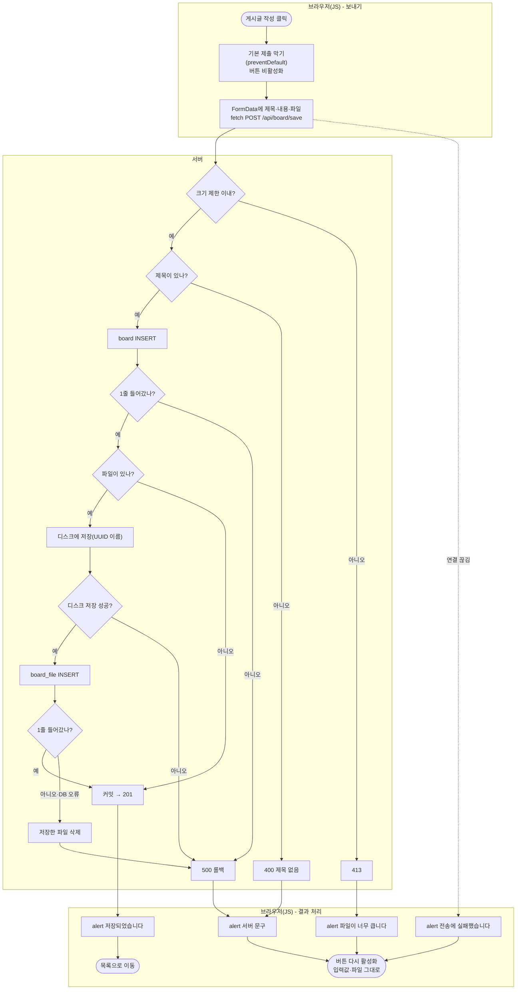
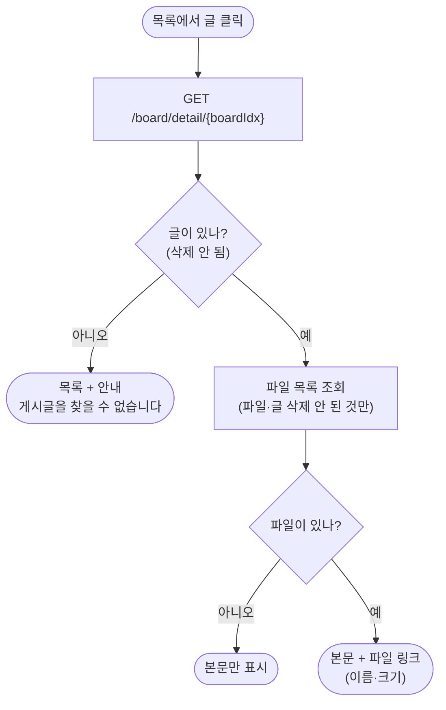
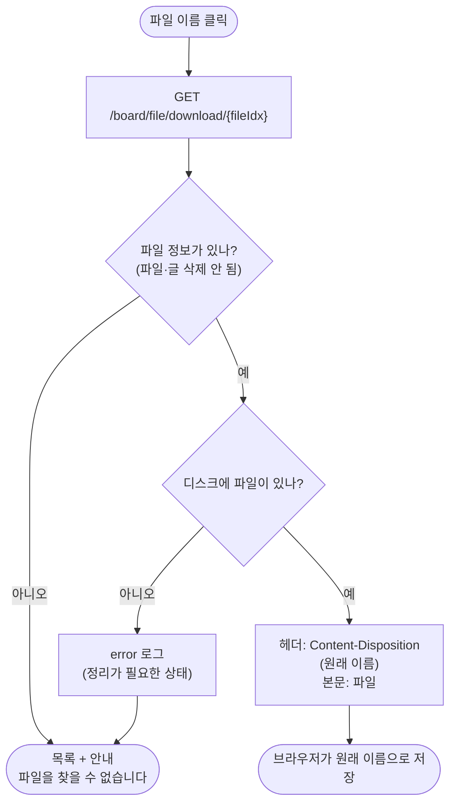

# 2026-10-27 작업 설계 — 글쓰기 fetch 저장, 첨부 파일 목록·내려받기

## 1. 개요

| 기능 | 목적 |
|---|---|
| ① 글쓰기 fetch 저장 | 피드백 반영: 저장 실패 시 화면이 초기화됨(입력값·파일 사라짐, 10/26), 버튼 중복 제출(10/19) |
| ② 첨부 파일 목록·내려받기 | 파일 입출력 중 "출력". 올린 파일을 상세에서 보고 받을 수 있게 |

- **오늘 하는 것**: 위 두 기능
- **안 하는 것**: 확장자 제한, 글 수정·삭제 때 파일 처리, 여러 파일 올리기(지금은 1개), 공용 파일 테이블

## 2. 화면 흐름

**① 글쓰기**
```
[글쓰기] 제목·내용·파일 입력 → [게시글 작성] 클릭 → 버튼 비활성화
  ├ 성공        → alert "저장되었습니다" → [목록]
  ├ 빈 제목     → alert(서버 문구) → 그대로 [글쓰기], 입력값·파일 유지, 버튼 다시 활성화
  ├ 저장 실패   → alert(서버 문구) → 위와 같음
  ├ 파일 큼     → alert "파일이 너무 큽니다" → 위와 같음
  └ 전송 실패   → alert "전송에 실패했습니다" → 위와 같음
```

**② 상세·내려받기**
```
[상세] 본문 아래 첨부 파일 목록(원래 이름, 크기) → 이름 클릭
  ├ 성공            → 브라우저가 원래 이름으로 저장
  └ 파일 없음       → [목록] + "파일을 찾을 수 없습니다"
```

## 3. 처리 흐름

**① 글쓰기 저장**
```
board_write.html (JS)
  submit 이벤트 → preventDefault(브라우저 제출 막기) → FormData(form) → fetch POST
→ BoardRestController.saveBoard(@ModelAttribute req, @RequestParam file)
→ BoardService.saveBoard(req, file)          @Transactional
    제목 검사 → board INSERT → (파일 있으면) FileStore.store → board_file INSERT
    board_file 기록 실패 시 FileStore.delete 후 예외 다시 던짐
→ 성공: 201 + ResponseDto  /  실패: ApiExceptionHandler가 상태 코드 + ResponseDto
→ JS: res.ok / res.status로 분기
```

**② 상세 + 파일 목록**
```
GET /board/detail/{boardIdx}
→ BoardController.boardDetail
→ BoardService.getBoard(boardIdx) + getBoardFileList(boardIdx)
→ BoardMapper.selectBoard + BoardFileMapper.selectBoardFileList
→ Model "board", "files" → board_detail.html (파일마다 내려받기 링크)
```

**② 내려받기**
```
GET /board/file/download/{fileIdx}   (상세의 링크 클릭 = 브라우저가 직접 요청)
→ BoardController.downloadBoardFile
→ BoardService.getBoardFile(fileIdx)
    BoardFileMapper.selectBoardFile(fileIdx) → 없으면 NotFoundException
    FileStore.load(saveName) → 디스크에 없으면 NotFoundException
→ ResponseEntity<Resource>
    헤더 Content-Disposition: attachment; filename*=UTF-8''(원래 이름)
    헤더 Content-Type: application/octet-stream
    본문 = 파일
```

## 3-1. 순서도

네모 = 하는 일, 마름모 = 판단, 둥근 칸 = 시작·끝.

**① 글쓰기 저장**



**② 상세 + 파일 목록**



**③ 내려받기**



## 4. API 명세

**① `POST /api/board/save`**

| 항목 | 내용 |
|---|---|
| 형식 | `multipart/form-data` |
| 칸 | `title` 필수, `content` 선택, `file` 선택(1개) |
| 201 | `{ "message": null, "data": { "title": "…", "content": "…" } }` |
| 400 | 빈 제목 → `{ "message": "제목을 넣어주세요.", "data": null }` |
| 500 | 기록 0줄 → `"저장이 완료되지 않았습니다. 다시 시도해주세요."` / 그 밖(파일 저장 실패 포함) → `"예상치 못한 오류입니다."` |
| 413 | 크기 초과. 컨트롤러 전 단계라 처리기를 거치지 않음 → **본문을 읽지 않고 상태 코드로만 판단** |

**② `GET /board/file/download/{fileIdx}`** (화면 컨트롤러, 링크로 호출)

| 항목 | 내용 |
|---|---|
| 경로 값 | `fileIdx` |
| 200 | 파일 본문 + `Content-Disposition`(원래 이름) |
| 실패 | `redirect:/board/list` + flash `errorMessage` |

## 5. 바꿀 파일

| 파일 | 새로/수정 | 내용 |
|---|---|---|
| `BoardRestController` | 수정(완료) | `saveBoard` 받는 쪽 `@RequestBody` → `@ModelAttribute` + `MultipartFile` |
| `board_write.html` | 수정 | form·버튼 id, `<script>`(submit → FormData → fetch → 분기) |
| `BoardFileMapper` + XML | 수정 | `selectBoardFileList(boardIdx)`, `selectBoardFile(fileIdx)` |
| `FileStore` | 수정 | `load(saveName)` → `Resource` |
| `BoardService` | 수정 | `getBoardFileList(boardIdx)`, `getBoardFile(fileIdx)` |
| `BoardController` | 수정 | `boardDetail`에 Model `files`, `downloadBoardFile` 추가 |
| `board_detail.html` | 수정 | 첨부 파일 목록 + 링크 |

## 6. 경우별 처리

| 경우 | 누가 잡나 | 사용자에게 보이는 것 |
|---|---|---|
| 빈 제목 | Service `BlankValueException` → 처리기 400 | alert, 입력 유지 |
| board·board_file 기록 0줄 | Service `DBNotAffectedException` → 처리기 500 (파일은 지움) | alert, 입력 유지 |
| 파일 디스크 저장 실패 | FileStore `UncheckedIOException` → 처리기 `Exception` 500 | alert, 입력 유지 |
| 파일 크기 초과 | 스프링 multipart 단계 → 413 | alert "파일이 너무 큽니다" |
| 전송 자체 실패(연결 끊김 등) | JS `catch` | alert "전송에 실패했습니다" |
| 연속 클릭 | JS 버튼 `disabled` | 두 번째 클릭 무시 |
| 없는 파일 번호 / 삭제 표시된 파일 / 삭제된 글의 파일 | 조회 결과 없음 → `NotFoundException` | 목록 + "파일을 찾을 수 없습니다" |
| DB엔 있는데 디스크에 없음 | `FileStore.load` 확인 → `NotFoundException` (로그 `error`, 정리가 필요한 상태) | 위와 같음 |

- 파일 조회는 `board_file.del_yn = 'N'` **그리고** 글(`board.del_yn = 'N'`)도 살아 있을 때만. 글을 지워도 파일 주소로 받아지는 일을 막기 위함.
- 내려받는 경로는 DB의 저장 이름(UUID)으로만 만든다. 사용자가 보낸 값으로 경로를 만들지 않는다(`../` 경로 공격 방지).

## 7. 확인 방법

| 해 볼 것 | 성공 기준 |
|---|---|
| 제목·파일 넣고 저장 | alert → 목록, 폴더에 UUID 파일, `board_file` 행 |
| 빈 제목 + 파일 골라 저장 | alert, 제목·내용·**파일 칸 유지** |
| 제한보다 큰 파일 | "파일이 너무 큽니다" alert, 입력 유지 |
| 버튼 빠르게 여러 번 | 글 1개만 생김 |
| 상세에서 파일 이름 클릭 | 원래 이름(한글 포함)으로 저장됨 |
| 주소창에 없는 `fileIdx` | 목록 + 안내 |
| 글 삭제 후 그 파일 주소 | 목록 + 안내 |

## 8. 정할 것 / 여쭤볼 것

1. 기존 form 저장 경로(`POST /board/save`)는 JS가 안 될 때를 위해 남길지, 지울지 — 지금 안: **남김**
2. 저장 성공 후 이동 — 지금 안: **목록**(상세로 가려면 API가 새 글 번호를 돌려줘야 함)
3. 파일 저장 실패(`UncheckedIOException`)의 문구 — 지금은 `Exception` 처리기의 "예상치 못한 오류입니다." 전용 처리기를 둘지
