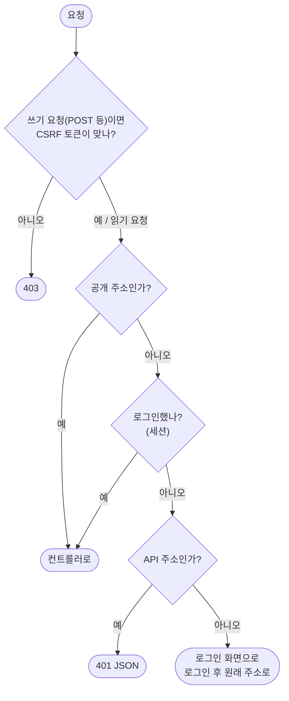

# 2026-10-28 작업 설계 — 스프링 시큐리티: 회원가입·로그인과 작성자 연결

여러 날에 걸친 작업의 전체 설계. 날마다 시작 전에 해당 단계를 다시 보고, 바뀐 것은 9장에 적는다.

## 1. 개요

| 항목 | 내용 |
|---|---|
| 목적 | 가이드의 마지막 과제 "스프링 시큐리티 회원가입·로그인" + **방식별 장단점 비교 후 왜 이 방식인지** 설명. 이어서 게시판의 임시 작성자(회원 번호 1)를 로그인한 회원으로 |
| 일정 | 10/29 ~ 11/04 구현, 11/05~06 미뤄 둔 피드백·여유 |
| 안 하는 것 | 소셜 로그인, 비밀번호 찾기·변경, 자동 로그인(remember-me), 회원 탈퇴·정보 수정, 관리자 기능, JWT |

**단계와 날짜**

| 단계 | 내용 | 날짜(안) |
|---|---|---|
| 1. 회원가입 | 가입 화면, 아이디 중복 확인, 비밀번호 BCrypt로 저장 | 10/29 |
| 2. 로그인·로그아웃 | 직접 만든 로그인 화면, DB 회원으로 로그인(`UserDetailsService`), 로그아웃 | 10/30 |
| 3. 주소 막기 | 공개/로그인 필요 주소 정리, API는 로그인 안 했으면 401 JSON, fetch에 CSRF 토큰 | 11/02 |
| 4. 작성자 연결 | 저장·수정·삭제의 임시 번호 1 → 로그인한 회원 번호 | 11/03 |
| 5. 본인 글만 | 남의 글 수정·삭제 막기, 화면에 본인 글일 때만 버튼 | 11/04 |

## 2. 방식 비교 — 왜 세션(폼 로그인)인가

| | 세션 + 폼 로그인 | JWT(토큰) | HTTP Basic |
|---|---|---|---|
| 로그인 상태를 어디에 두나 | **서버**가 세션에 기억, 브라우저는 세션 쿠키만 | **클라이언트**가 토큰을 들고 매 요청 헤더에 | 기억 안 함, 매 요청에 아이디·비밀번호 |
| 로그아웃 | 서버에서 세션을 지우면 끝 | 토큰은 만료 전까지 유효 → 막으려면 차단 목록 등 추가 장치 | 브라우저를 닫아야 |
| CSRF | 쿠키가 자동으로 실리니 **CSRF 방어 필요**(스프링이 기본 제공) | 헤더에 직접 넣으니 CSRF 걱정 적음 | 필요 |
| 어울리는 곳 | **서버가 화면을 그리는 웹**(Thymeleaf), 같은 서버로 가는 fetch | 화면과 서버가 분리된 구조(React 등), 모바일 앱, 여러 서버 | 내부 도구, 시험용 |
| 구현량 | 스프링 기본 기능으로 대부분 | 발급·검증 필터, 저장·만료·재발급 직접 | 가장 적음 |

**결정: 세션 + 폼 로그인.** 브라우저에는 쿠키·세션이 이미 있고 화면을 서버가 그리는 구조라 있는 것을 쓰는 게 맞다. 토큰 방식(JWT)은 세션이 불가능하거나 불편한 구조(화면·서버 분리, 앱, 여러 서버)에서 고르는 방식이다. 구조가 바뀌면 그때 JWT를 고른다.

- 이 프로젝트는 화면을 서버(Thymeleaf)가 그리고, fetch도 **같은 서버**로 보낸다. 브라우저가 세션 쿠키를 자동으로 실어 주니 로그인 상태 유지에 따로 할 일이 없다.
- 로그아웃이 확실하다(서버에서 세션을 지움).
- 스프링 시큐리티의 기본 흐름(폼 로그인·세션·CSRF)을 그대로 쓰며 원리를 익히기 좋다.
- JWT는 화면과 서버가 분리되거나 앱이 붙을 때 맞는 방식이다. 회사(탭탭)는 앱과 프런트가 따로 있어 JWT를 쓴다 — 구조가 달라서 고르는 방식도 다르다.

## 3. 구조 — 새로 생길 파일

(10/28 구조 정리: 도메인별 `board/`·`member/`·`common/`)

```
com.study.skillup
├─ config/
│   └─ SecurityConfig            주소 규칙, 폼 로그인·로그아웃, 비밀번호 인코더, API 401
├─ member/
│   ├─ controller/  MemberController   가입 화면·로그인 화면 (지금 있는 연습용 메서드는 정리)
│   │               MemberRestController  가입 처리 API `POST /api/member/join`
│   ├─ service/     MemberService      가입(중복 확인, BCrypt)
│   │               MemberDetailsService  UserDetailsService 구현(아이디로 회원 찾기)
│   ├─ mapper/      MemberMapper (+ resources/mapper/MemberMapper.xml)
│   ├─ dto/         JoinRequest        가입 화면에서 받는 칸(아이디·비밀번호·이름)
│   ├─ security/    LoginMember        로그인한 회원 정보(회원 번호 포함) — UserDetails 구현
│   └─ vo/          MemberVo (있음)
└─ common/exception/  DuplicateException 등 필요한 예외

templates/member/  join.html, login.html
```

- `LoginMember`에 **회원 번호(`memberIdx`)를 담는 이유**: 4단계에서 "지금 로그인한 사람의 회원 번호"가 필요하다. 스프링 기본 `User`에는 아이디·비밀번호·권한만 있다.
- `security-practice` 브랜치는 합치지 않고 참고만 한다(10/28 결정).

## 4. 주소 규칙

| 주소 | 로그인 | 비고 |
|---|---|---|
| `/`, `/board/list`, `/board/detail/**`, `/board/fetch`, `/api/board/list` | 공개 | 보기만 하는 곳 |
| `/board/file/download/**` | 공개 | 정할 것 2 |
| `/member/join`(화면·처리), `/member/login`(화면) | 공개 | 로그인 처리 주소는 시큐리티가 만듦 |
| `/error` | 공개 | 막으면 오류가 401로 바뀌어 보임(10/23 실습) |
| 그 밖(`/board/write`, `/board/edit/**`, `/board/update/**`, `/board/delete/**`, `/api/board/save` …) | **로그인 필요** | |

**로그인 안 한 사람이 막힌 주소로 오면**

| 요청 | 응답 |
|---|---|
| 화면 주소(`/board/**`) | 로그인 화면으로 이동 → 로그인하면 원래 가려던 곳으로 |
| API 주소(`/api/**`) | **401** + `ResponseDto` JSON("로그인이 필요합니다.") — fetch가 로그인 화면 HTML을 받지 않도록 |

## 5. 단계별 흐름

### 5-1. 회원가입

```
[가입 화면] 아이디·비밀번호·이름 → 제출 → JS가 막고 FormData → fetch POST /api/member/join (CSRF 헤더)
→ MemberRestController.join(JoinRequest)
→ MemberService.join
    빈 칸 검사 → 400 성격(BlankValueException)
    비밀번호 규칙 검사(8자 이상, 영문·숫자 포함) → 400
    아이디 중복 검사(selectMemberByUserId) → 있으면 DuplicateException
    비밀번호 BCrypt 암호화(PasswordEncoder.encode)
    member INSERT(role·use_yn·reg_dttm은 DB 기본값) → 0줄이면 DBNotAffectedException
→ 성공: 201 → JS가 alert "가입되었습니다" → 로그인 화면으로 이동
→ 실패: 처리기가 상태 코드 + 문구(빈 칸 400, 아이디 중복 409, 저장 실패 500) → JS가 alert, 페이지 그대로(입력 유지)
```

### 5-2. 로그인

```
[로그인 화면] 아이디·비밀번호 → POST /member/login (시큐리티 필터가 받음, 컨트롤러 없음)
→ MemberDetailsService.loadUserByUsername(아이디)
    MemberMapper.selectMemberByUserId → 없거나 use_yn='N'이면 UsernameNotFoundException
    → LoginMember(회원 번호, 아이디, 암호화된 비밀번호, 권한)
→ 시큐리티가 입력 비밀번호와 암호화된 비밀번호를 비교(BCrypt)
→ 성공: 세션에 로그인 정보 저장 → 원래 가려던 곳 또는 목록
→ 실패: 로그인 화면 + "아이디 또는 비밀번호가 맞지 않습니다"
```

- 비밀번호 비교는 우리가 하지 않는다. 시큐리티가 `PasswordEncoder`로 한다.
- 실패 문구는 아이디가 없는지 비밀번호가 틀렸는지 **구분하지 않는다**(아이디 존재 여부를 알려 주지 않기 위해).

### 5-3. 주소 막기 + fetch CSRF

- `SecurityConfig`에 4장 규칙.
- 글쓰기 fetch 저장: 세션 방식은 CSRF 토큰이 필요하다. 화면에 `<meta name="_csrf" th:content="${_csrf.token}">`, `<meta name="_csrf_header" th:content="${_csrf.headerName}">`를 두고 fetch 헤더에 담는다(10/26 템플릿을 고른 이유). 나중에 `templates/common/` 조각으로.
- CSRF 검사는 로그인 여부보다 **먼저** 돈다(10/23 실습). 그래서 공개 주소라도 쓰기 요청이면 토큰이 필요하다: 가입 form·로그인 form은 `th:action`이 숨은 칸으로 넣어 주고, fetch는 위 헤더로.
- 로그아웃은 **POST**(GET이면 다른 사이트가 링크 하나로 로그아웃시킬 수 있음).

### 5-4. 작성자 연결

- 저장·수정·삭제에서 임시 번호 1(Service 3곳) → 컨트롤러가 `@AuthenticationPrincipal LoginMember`로 받은 회원 번호를 Service에 넘김.
- 화면 저장 경로(예비 경로)와 API 저장 경로 둘 다 같은 Service를 부르므로 Service 쪽 시그니처만 바꾸면 된다.

### 5-5. 본인 글만

- 수정·삭제 전에 글의 `member_idx`와 로그인 회원 번호를 비교 → 다르면 막음.
- 상세 화면의 수정·삭제 버튼은 본인 글일 때만 보이게(시큐리티 Thymeleaf 확장 또는 Model 값).
- 응답은 정할 것 3.

## 6. 순서도

**가입**


**요청이 들어올 때(시큐리티 필터)**



## 7. 경우별 처리

| 경우 | 누가 잡나 | 사용자에게 보이는 것 |
|---|---|---|
| 가입 빈 칸 | Service `BlankValueException` → 처리기 400 | alert, 페이지 그대로 |
| 비밀번호 규칙 위반 | Service 검사 → 처리기 400 | alert 규칙 안내, 페이지 그대로 |
| 가입 아이디 중복 | Service 중복 검사 → 새 예외 → 처리기 **409** | alert "이미 사용 중인 아이디", 페이지 그대로 |
| 같은 아이디로 동시에 가입(중복 검사 통과 뒤 INSERT 때 UNIQUE 위반) | DB `DuplicateKeyException` | 위와 같은 안내 |
| 로그인 아이디 없음·비밀번호 틀림·사용 중지 회원 | 시큐리티 | 로그인 화면 + 같은 실패 문구 |
| 로그인 안 하고 화면 주소 | 시큐리티 | 로그인 화면 → 로그인 후 원래 주소 |
| 로그인 안 하고 API 주소 | 시큐리티(진입점) | 401 JSON → fetch가 alert |
| CSRF 토큰 없음·틀림 | 시큐리티 `CsrfFilter` | 403 |
| 남의 글 수정·삭제 | Service 비교 | 정할 것 3 |

## 8. 확인 방법

| 해 볼 것 | 성공 기준 |
|---|---|
| 가입 | DB `pwd`가 `$2a$…`로 시작하는 암호문(평문 아님) |
| 같은 아이디로 다시 가입 | 안내, 입력 유지 |
| 맞는/틀린 비밀번호로 로그인 | 성공 시 이동, 실패 시 같은 문구 |
| 로그아웃 후 글쓰기 주소 | 로그인 화면 → 로그인하면 글쓰기로 |
| 로그아웃 후 fetch 저장(API) | 401 alert |
| 로그인 후 fetch 저장 | 저장됨(CSRF 헤더) |
| 저장한 글의 작성자 | 로그인한 회원 번호 |
| 다른 계정으로 남의 글 수정·삭제 | 막힘 |

(자동 시험: 가입 단계에서 MockMvc 첫 테스트를 같이 써 보는 안 — TODO)

## 9. 정할 것 / 여쭤볼 것

0. ~~**로그인 방식**~~ → **세션 + 폼 로그인으로 결정**(10/28, 2장 끝 문단의 이유)
1. ~~**가입 화면 방식**~~ → **fetch로 결정**(10/28). 원칙: **실패하면 그 자리에 머물게 한다** — 다시 찾아가거나 다시 입력하게 만들지 않고(불쾌감), 주소가 안 바뀌니 flash 제약도 없음. 댄의 10/26 "alert 띄우고 JS에서 이동"과 같은 방향. 로그인 화면만 시큐리티 폼 로그인(form) 그대로. 시큐리티를 켜면 글쓰기 fetch에도 CSRF 헤더가 필요하므로 가입 단계에서 meta 태그부터
2. **내려받기 공개 여부**: 지금은 상세가 공개라 내려받기도 공개. 로그인한 사람만 받게 할지
3. **남의 글 수정·삭제 응답**: 403(권한 없음) vs 404(글이 있다는 것도 숨김). 안: 403 — 상세는 공개라 글의 존재는 이미 보임
4. **가입 직후**: 로그인 화면으로(안) vs 자동 로그인
5. ~~**비밀번호 규칙**~~ → **8자 이상 + 영문·숫자 둘 다 포함으로 결정**(10/28). Service에서 검사(화면 검사는 편의일 뿐), 안 맞으면 400 "비밀번호는 8자 이상, 영문과 숫자를 모두 포함해야 합니다". 정규식 예: `^(?=.*[A-Za-z])(?=.*\d).{8,}$`
6. `MemberController`의 연습용 메서드(`/hello` 등): 지우기(안) vs 남기기. `/`(메인)는 남김
7. 지금 DB의 임시 회원(회원 번호 1)과 그 글들: 그대로 두고, 그 회원 비밀번호는 평문이면 로그인 불가 → 시험용 회원은 가입 화면으로 새로 만듦(안)

## 10. 검토 반영

| # | 받은 의견 | 바꾼 것 | 이유 |
|---|---|---|---|
